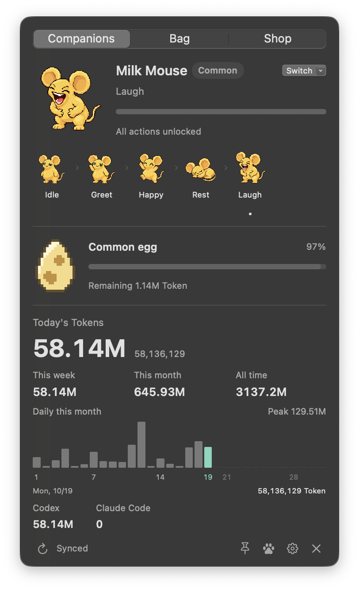
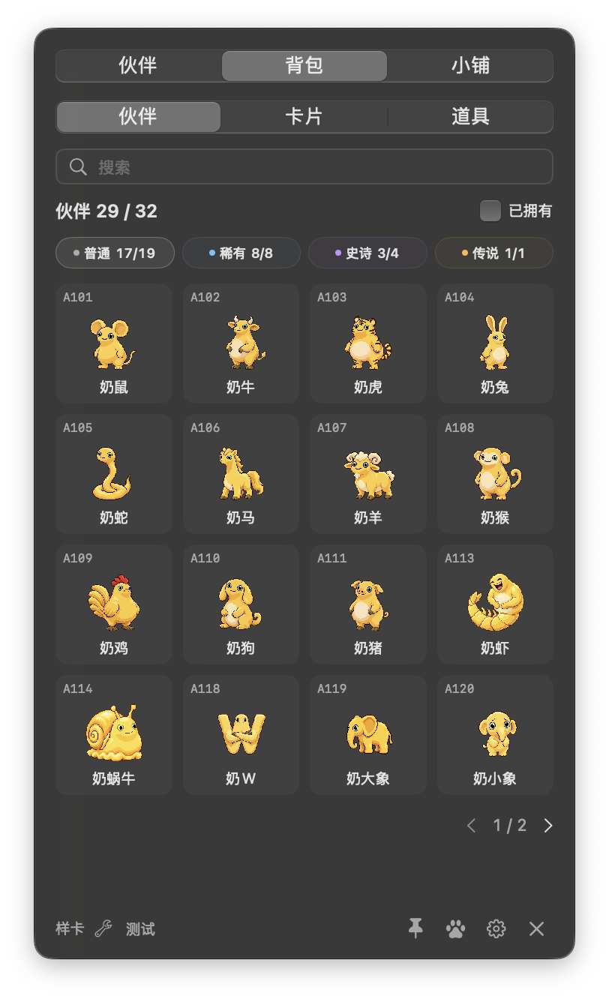
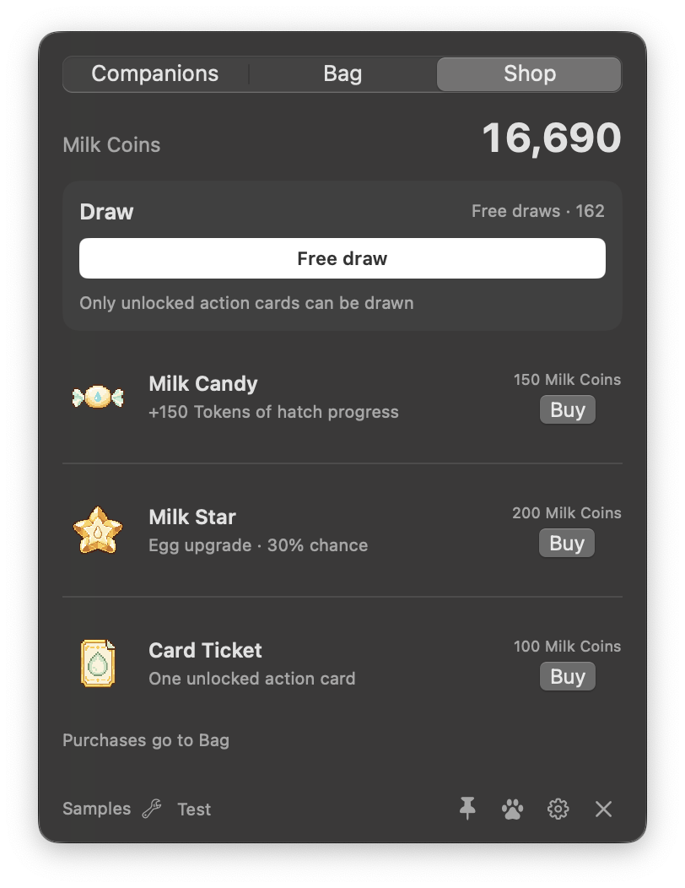
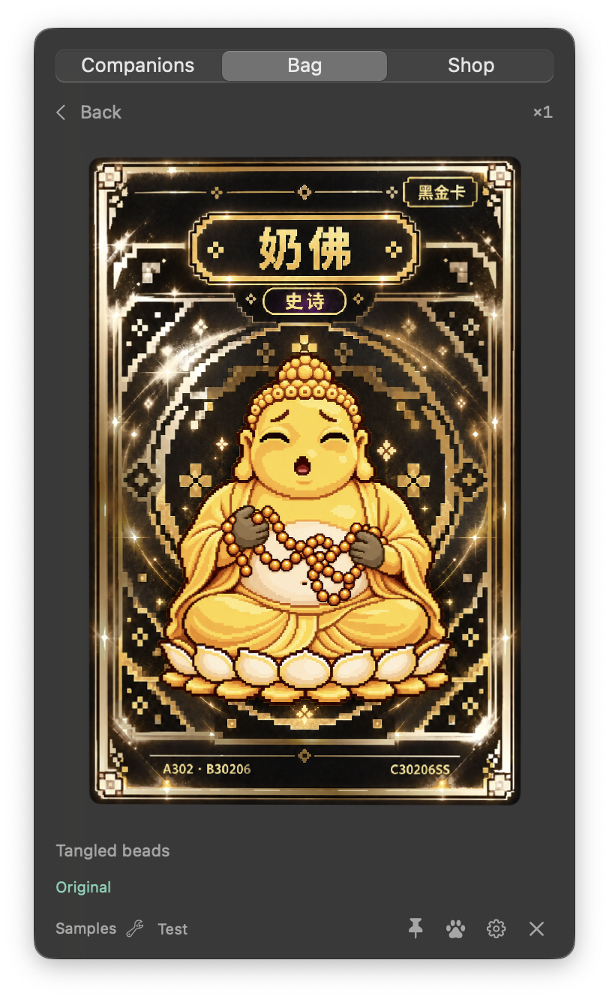

# Milk Family · 奶家族

**Codex / Claude Code usage tracking, desktop companions and collection gameplay.**

[English](README.md) · [简体中文](README.zh-CN.md)

Milk Family is a native macOS app that reads actual Token usage from local logs. New usage grows companions, unlocks actions, hatches characters and earns cards. Companions are referred to as **奶娃**, and the character roster as **奶家人**.

**1.0.0 · macOS 14+ · English / 简体中文 · 32 characters · 179 animated actions · 175 cards**

<p align="center"></p>
<p align="center"><strong>成年奶娃 · Adult Milk Frog</strong></p>

## Installation

Download **v1.0.0** from [Releases](https://github.com/jaysoncbh/MilkFamily/releases).

1. Use an **Apple Silicon / M-series Mac with macOS 14 or later**. Intel builds are not currently available.
2. Download **`MilkFamily-1.0.0-macOS-arm64.zip`**. The `Source code` archives and `MilkFamily-Source-…zip` contain developer sources.
3. Extract the ZIP, drag **`奶家族.app` into Applications**, and open it.
4. English is the default. Choose a Common starter and claim its idle card in Shop; change languages under **Settings → Language**.
5. Local Codex / Claude Code logs are detected automatically. Select their folder in Settings if none are found.

The app includes its characters, cards and animations; no separate asset pack or compiler is needed. **This release is ad-hoc signed and has not been notarized by Apple**; macOS may require confirmation on first launch. See [installation instructions](docs/INSTALL.md).

## Adult Milk Frog · 成年奶娃

The main character is **成年奶娃** (A201; collection name 成年奶蛙, English name **Adult Milk Frog**), a Rare companion obtained through hatching. Six actions unlock through growth. **捧腹大笑** (Belly laugh) is the 奶娃’s signature **绷不住** expression.

<table>
<tr>
<td align="center" width="33%"><br><strong>Idle</strong></td>
<td align="center" width="33%"><br><strong>Tai chi</strong></td>
<td align="center" width="33%"><br><strong>捧腹大笑 / Belly laugh</strong></td>
</tr>
<tr>
<td align="center" width="33%"><br><strong>Rest</strong></td>
<td align="center" width="33%"><br><strong>Wave</strong></td>
<td align="center" width="33%"><br><strong>Happy hop</strong></td>
</tr>
</table>

## 奶家人 · Action previews

<table>
<tr>
<td align="center" width="33%"><br><strong>Milk Mouse · Common</strong><br>捧腹大笑 / Belly laugh</td>
<td align="center" width="33%"><br><strong>Milk Garlic · Epic</strong><br>Green puff giggles</td>
<td align="center" width="33%"><br><strong>Pink Milk Cat · Legendary</strong><br>Knead</td>
</tr>
</table>

## Character roster

**32 characters: 19 Common, 8 Rare, 4 Epic and 1 Legendary.**

| Rarity | Count | Companions |
| --- | ---: | --- |
| Common | 19 | Milk Mouse · Milk Ox · Milk Tiger · Milk Rabbit · Milk Snake · Milk Horse · Milk Goat · Milk Monkey · Milk Rooster · Milk Dog · Milk Pig · Milk Fish · Milk Shrimp · Milk Snail · Milk Poo · Milk W · Milk Elephant · Milk Baby Elephant · Milk Bird |
| Rare | 8 | **Adult Milk Frog (main companion)** · Milk Dumpling · Milk Trump · Chinese Milk Dragon · Milk Bug · Milk Sponge · Milk Starfish · Milk Boss |
| Epic | 4 | Milk Dragon · Milk Buddha · Milk Garlic · Milk Powder |
| Legendary | 1 | Pink Milk Cat |

[Full bilingual names, IDs and action counts](docs/COMPANIONS.md).

## Token statistics

The home panel shows **daily, weekly, monthly and all-time Tokens** for Codex and Claude Code, with a daily bar chart and exact values. Dates use the local time zone; weeks begin on Monday.

Local logs refresh every 15 seconds and are deduplicated. History contributes to statistics; newly observed usage after setup earns game progress. Item bonuses do not change actual Token records. The app does not estimate API costs.

<p align="center"></p>

## Desktop companions

Drag, resize or hide the companion, move it partly beyond a screen edge, or pin the panel. Click to open the panel; right-click to select an unlocked action.

**All 179 actions have continuous animation, totaling 912 frames.** Every character has **捧腹大笑** (Belly laugh), available in character previews and on the desktop.

## Progression

1. Choose a Common companion and claim its idle card in Shop.
2. New real Token usage grows the active companion and unlocks actions.
3. After all actions unlock, start an egg to obtain another character.
4. Use Bag to manage companions, cards and items, with search and rarity filters.

**Base rules at 100% difficulty:**

| Progress or reward | Requirement |
| --- | --- |
| Next action | Every 20M Tokens |
| Egg hatch | 50M Tokens per egg |
| Milk Coin | One per 1M Tokens |
| Free draw | One per 100M Tokens |

Difficulty ranges from 20% to 500% and scales growth, hatching, reward intervals and shop prices while preserving unlocked actions. Eggs have Common, Rare, Epic and Legendary grades; upgrades exclude lower rarities. Repeat hatches gently reduce a character’s relative weight within its rarity, down to half its initial weight, without changing total rarity probabilities.

<p align="center"></p>

## Shop and items

| Item | Base price | Effect |
| --- | ---: | --- |
| Milk Candy | 150 Milk Coins | Adds 150 Tokens of hatch bonus progress; actual usage, coins and free draws stay unchanged. |
| Milk Star | 200 Milk Coins | 30% chance to upgrade the current egg by one grade. |
| Card Ticket | 100 Milk Coins | Draws one card for an unlocked action. |

Purchases enter Bag and take effect when used. Free draws and Card Tickets use the unlocked-action pool.

<p align="center"></p>

## Card system

**175 cards: 127 Common, 31 Shiny, 14 Black Gold and 3 Spectral.** Card style is independent of character rarity. Cards become eligible when their actions unlock.

**20 advanced cards support interactive effects**, including pointer tilt, parallax, moving foil light, metallic glints and layered stars. Other cards remain static.

<p align="center"></p>

Card artwork retains its Chinese lettering; the interface supports both languages. Shop, collection and card screenshots show the test edition; its Samples and Test controls are absent from the regular edition. Progress shown is illustrative.

## Language, appearance and privacy

- New saves default to English, with Simplified Chinese available. Updates retain the saved language.
- System, Light and Dark appearances respect macOS Reduce Motion and Reduce Transparency.
- Usage and progress stay local. No API key is required; logs, prompts, responses and saves are not uploaded.
- Alternative Claude Code API setups are counted when supported usage fields exist in local logs. Missing usage is not estimated.

See [Usage and privacy](docs/Usage_and_Privacy.md).

## Building from source

Run source checks:

```sh
./scripts/check.sh
```

Developer app builds require a separate authorized runtime asset pack; see [build instructions](docs/BUILD.md). Hosted CI, notarization and download acceptance are tracked in the [release checklist](docs/RELEASE_CHECKLIST.md).

## License

Source code and written documentation use [MIT](LICENSE), credited to `Copyright (c) 2026 Milk Family contributors`. Character art, cards, animations and screenshots are covered separately by [asset rights](ASSET_RIGHTS.md). See the [license guide](docs/LICENSE_GUIDE.md).

## Credits

Interface and local-usage design reference [PokeTokenBar](https://github.com/chattymin/PokeTokenBar). Its [upstream MIT notice](licenses/PokeTokenBar-MIT.txt) is preserved separately; see [NOTICE](NOTICE.md).
